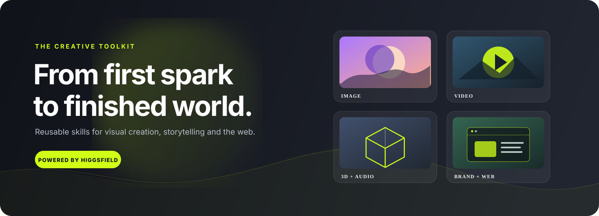
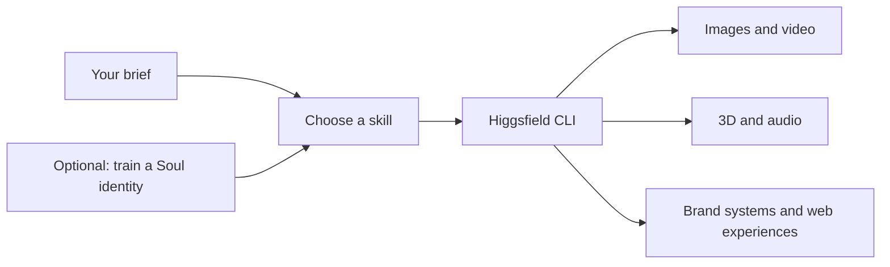

<p align="center">
  
</p>

<h1 align="center">Creative Forge</h1>

<p align="center">
  A creative toolkit for turning ideas into images, video, 3D assets, brand systems, and web experiences.
  <br>
  Powered by reusable agent skills and the <a href="https://github.com/higgsfield-ai/cli">Higgsfield CLI</a>.
</p>

<p align="center">
  <a href="./LICENSE"></a>
  
  <a href="#what-is-inside"></a>
</p>

<p align="center">
  
</p>

> **A personal project by [@byrapogubrihithbt26ece-alt](https://github.com/byrapogubrihithbt26ece-alt).** Creative Forge is inspired by and adapted from [Higgsfield AI's original open-source skills repository](https://github.com/higgsfield-ai/skills). This edition adds its own presentation, field guides, artwork, and community contribution path while keeping the upstream skill workflows and assets credited to their authors under the original MIT license. It is an independent project, not an official Higgsfield AI release.

## What is inside

| Skill | Use it for |
|---|---|
| [**Generate**](./higgsfield-generate) | Create images, video, 3D and audio, plus branded ads and video analysis. |
| [**Soul ID**](./higgsfield-soul-id) | Train a reusable character identity for consistent image and video generation. |
| [**Product Photoshoot**](./higgsfield-product-photoshoot) | Make polished product imagery, lifestyle scenes, campaign visuals and virtual try-ons. |
| [**Brandkit**](./higgsfield-brandkit) | Build or extend a complete visual identity, from logo and typography to brandbooks. |
| [**Marketplace Cards**](./higgsfield-marketplace-cards) | Create marketplace-ready primary, secondary and A+ product content. |
| [**Websites**](./higgsfield-websites) | Build, refine and deploy websites, web apps and browser games. |
| [**Faceless Video**](./higgsfield-faceless-video) | Produce narrated explainers, documentaries, stories and music videos. |
| [**Video Explainer**](./higgsfield-video-explainer) | Compatibility entry for the faceless-video workflow. |
| [**YouTube Thumbnail**](./higgsfield-youtube-thumbnail) | Design truthful, high-impact thumbnails and vertical video covers. |

Skills work with Claude Code, Cursor, Codex and other agents that support Markdown-based skills. Each skill folder includes its own usage guidance and references.

## A simple creative flow



Train a Soul identity when you need a consistent person or character, then pass its reference into generation. Use Brandkit for a coordinated identity, or Websites to turn creative assets into a working web experience.

## Get started

The skills use the Higgsfield CLI for authentication, generation, and results.

### Install with `npx skills`

```bash
npx skills add byrapogubrihithbt26ece-alt/higgsfield-creative-forge
```

### Install with GitHub CLI

Requires GitHub CLI 2.90 or later:

```bash
gh skill install byrapogubrihithbt26ece-alt/higgsfield-creative-forge
```

### Install the Claude Code plugin

```text
/plugin marketplace add byrapogubrihithbt26ece-alt/higgsfield-creative-forge
/plugin install higgsfield@higgsfield
```

### Run the setup script

```bash
git clone --depth 1 https://github.com/byrapogubrihithbt26ece-alt/higgsfield-creative-forge.git
cd higgsfield-creative-forge
./setup
```

See [INSTALL.md](./INSTALL.md) for all installation options and [INSTALL_FOR_AGENTS.md](./INSTALL_FOR_AGENTS.md) for the agent-driven runbook.

## Built for creative work

- **Move from idea to output:** pick a focused skill instead of assembling every workflow from scratch.
- **Keep identity consistent:** train a Soul Character once and reuse it across supported generations.
- **Make a full visual system:** carry an approved identity across graphics, packaging, presentations and more.
- **Go beyond a single asset:** build sites and games that bring generated media into a complete experience.

## Help shape Creative Forge

Found a rough edge or have an idea? Start with the [issue tracker](https://github.com/byrapogubrihithbt26ece-alt/higgsfield-creative-forge/issues). Use the [bug report](./.github/ISSUE_TEMPLATE/bug_report.md), [feature request](./.github/ISSUE_TEMPLATE/feature_request.md), or [new skill proposal](./.github/ISSUE_TEMPLATE/new_skill_request.md) template so the right details are easy to share.

Ready to improve something? Read the [contribution guide](./CONTRIBUTING.md), then send a [pull request](./.github/pull_request_template.md) to this repository. Small, focused changes are easiest to review; please keep upstream credit intact and include the checks you ran.

## License and attribution

This copy retains the original [MIT License](./LICENSE). Higgsfield AI and the upstream contributors retain attribution for their work. For the canonical project and latest official updates, visit [higgsfield-ai/skills](https://github.com/higgsfield-ai/skills).
