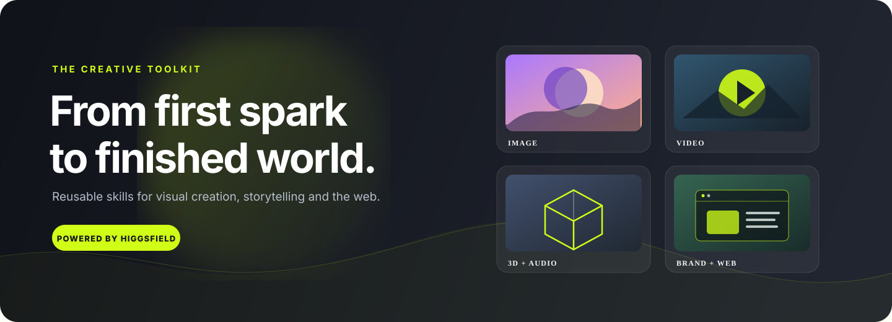

# Visual assets

These files are presentation assets. Skills do not load them at runtime.

| Asset | Purpose | Attribution |
|---|---|---|
| `logo.png` | Higgsfield wordmark shown at the top of the repository README. | Original upstream asset; preserved from Higgsfield AI. |
| `icon.svg` | Higgsfield icon retained from the upstream repository. | Original upstream asset; preserved from Higgsfield AI. |
| `creative-forge-banner.svg` | Custom overview graphic used in the repository README. | Created for this repository; not an official Higgsfield AI brand asset. |

  

## Future additions

Product screenshots or short demos can make the README more useful. Only add media that shows real, verified output from the corresponding workflow; avoid mock screenshots that could be mistaken for generated results.

Keep demo GIFs optimized (under 2 MB where practical), looped, and focused on one workflow. Preserve attribution when reusing any upstream asset.
